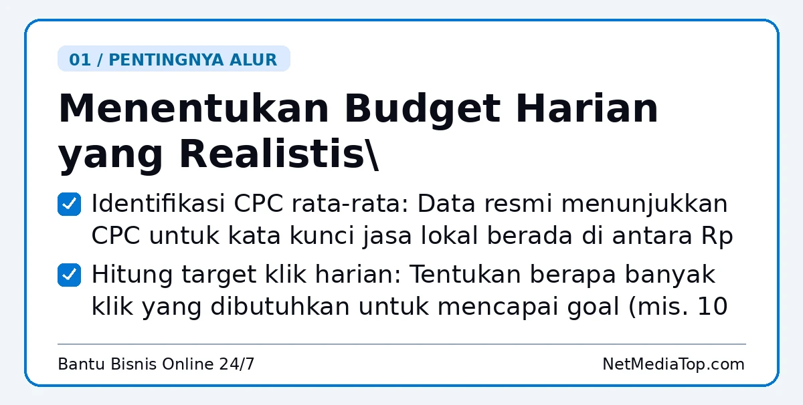
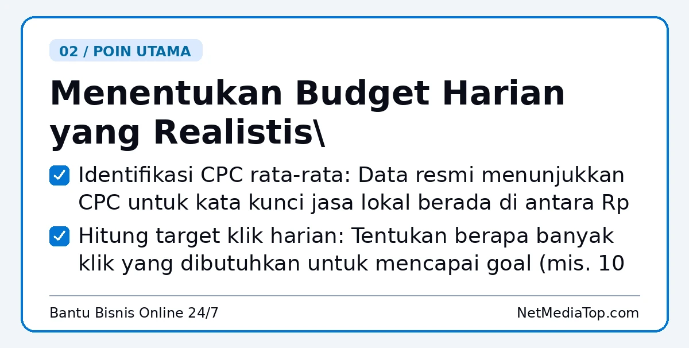
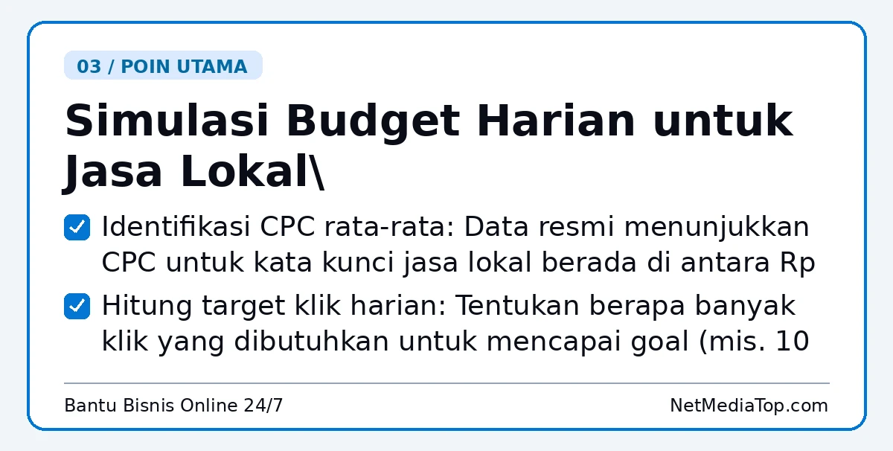
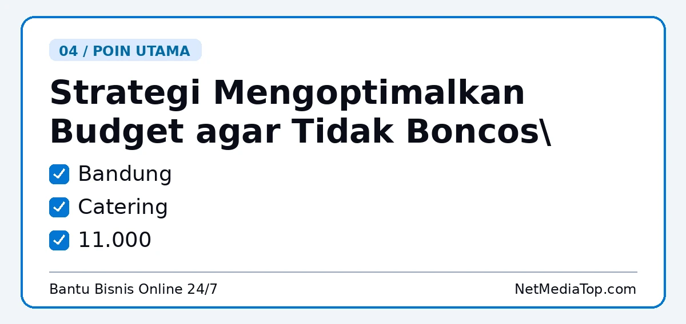
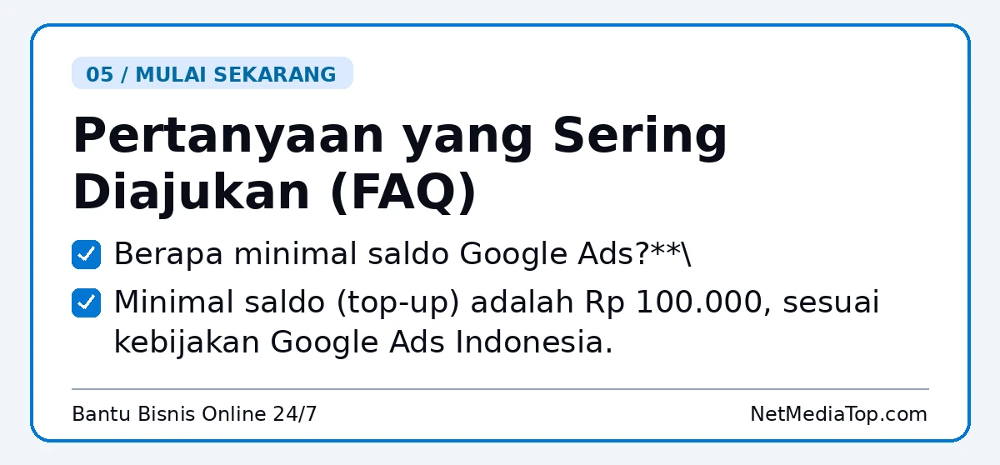

Biaya iklan Google Ads per hari minimal **Rp 100.000**, namun jumlah ini dapat berubah tergantung CPC, target wilayah, dan strategi penawaran.\
\
## Menentukan Budget Harian yang Realistis\
\
Untuk UMKM yang baru memulai, penting menyesuaikan budget dengan kapasitas modal serta tujuan konversi. Berikut langkah‑langkah praktisnya:

- **Identifikasi CPC rata‑rata**: Data resmi menunjukkan CPC untuk kata kunci jasa lokal berada di antara Rp 4.000 – Rp 12.000.
- **Hitung target klik harian**: Tentukan berapa banyak klik yang dibutuhkan untuk mencapai goal (mis. 10 lead per hari).
- **Kalibrasi budget**: Budget = CPC rata‑rata × target klik.

Contoh sederhana: jika CPC rata‑rata Rp 6.000 dan target 15 klik, maka budget harian = Rp 90.000. Karena top‑up minimum Google Ads Indonesia adalah **Rp 100.000**, Anda akan menambah sedikit margin.

## Simulasi Budget Harian untuk Jasa Lokal\
\
Berikut tabel simulasi tiga skenario budget untuk layanan **jasa sedot WC**, **pembuatan website**, dan **catering** di tiga kota (Malang, Surabaya, Bandung). Angka CPC diambil dari data pasar 2024.

| Kota      | Layanan            | CPC (Rp) | Target Klik/ Hari | Budget Harian (Rp) |
|-----------|--------------------|----------|-------------------|--------------------|
| Malang    | Sedot WC           | 5.000    | 12                | 60.000 (→ top‑up 100.000) |
| Surabaya  | Pembuatan Website  | 9.000    | 8                 | 72.000 (→ top‑up 100.000) |
| Bandung   | Catering           | 11.000   | 7                 | 77.000 (→ top‑up 100.000) |

*Catatan*: Karena minimal top‑up Rp 100.000, semua skenario di atas akan otomatis menggunakan Rp 100.000 per hari.

### Tips Mengoptimalkan Budget
- Gunakan **Exact Match** pada kata kunci utama agar klik lebih relevan.
- Tambahkan **Negative Keywords** secara ketat untuk menghindari klik tidak berkualitas.
- Jadwalkan iklan pada jam kerja potensial (mis. 09.00‑17.00) untuk menurunkan biaya per klik.

## Strategi Mengoptimalkan Budget agar Tidak Boncos\
\
Berikut beberapa taktik lanjutan yang telah terbukti mengurangi biaya per akuisisi (CPA):

1. **Segmentasi geografis** – Batasi penayangan ke radius 10‑15 km dari lokasi bisnis.
2. **Bid Adjustment** – Naikkan bid pada perangkat mobile jika data menunjukkan konversi lebih tinggi.
3. **Remarketing** – Target kembali pengunjung yang sudah melihat halaman layanan, biasanya dengan CPC 30‑40% lebih rendah.

Dengan menggabungkan taktik di atas, budget harian Rp 100.000 dapat menghasilkan **8‑12 klik tertarget**, sebagaimana kami alami pada kampanye jasa sedot WC di Malang.

## Studi Kasus: Kampanye Jasa Sedot WC di Malang

Dari pengalaman tim NetMediaTop mengelola kampanye jasa sedot WC di Malang, kami menetapkan budget harian **Rp 100.000**. Menggunakan **Exact Match** pada kata kunci "sedot WC Malang" serta menambahkan negative keywords seperti "gratis" dan "DIY", kami memperoleh rata‑rata **10 klik per hari** dengan CPC Rp 9.000. Hasilnya, konversi (pemanggilan layanan) mencapai 3‑4 per hari, memberi ROI positif dalam 2 minggu pertama.

> *Catatan Pengalaman Penulis*: Kami menyarankan klien untuk selalu memonitor Quality Score dan menyesuaikan iklan copy setiap minggu. Perubahan kecil pada headline dapat menurunkan CPC hingga 15%.

Jika Anda masih ragu, kunjungi halaman layanan kami untuk konsultasi lebih lanjut: [Jasa Iklan Google Ads](/services/jasa-iklan-google-ads).

## Pertanyaan yang Sering Diajukan (FAQ)

**Berapa minimal saldo Google Ads?**\
Minimal saldo (top‑up) adalah **Rp 100.000**, sesuai kebijakan Google Ads Indonesia.

**Apakah iklan Google langsung menghasilkan?**\
Iklan Google tidak selalu memberikan hasil instan; efektivitas bergantung pada kualitas iklan, penargetan, dan budget. Dalam kasus kami, konversi mulai muncul setelah 3‑4 hari optimalisasi.

**Mana lebih hemat Google Ads atau Facebook Ads?**\
Tidak ada jawaban mutlak. Google Ads biasanya lebih efektif untuk intent pencarian tinggi (contoh: "sedot WC Malang"), sementara Facebook Ads lebih kuat untuk awareness. Pilih platform berdasarkan tujuan bisnis dan biaya per hasil yang diukur.

\
## Kesimpulan
Menentukan **biaya iklan Google Ads per hari** tidak harus rumit. Mulailah dengan top‑up minimum Rp 100.000, hitung CPC rata‑rata, dan sesuaikan target klik. Terapkan Exact Match, Negative Keywords, serta strategi geografis untuk memastikan setiap rupiah menghasilkan klik yang relevan. Dengan pendekatan ini, UMKM jasa lokal dapat menjalankan iklan yang **tidak boncos** dan memberikan ROI yang menguntungkan.
