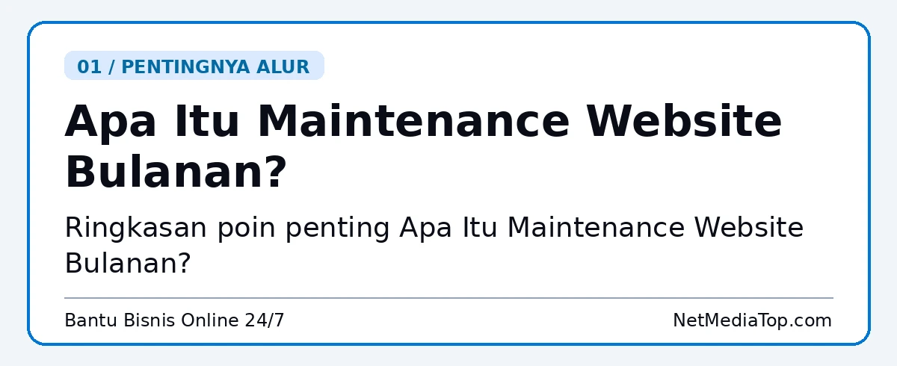
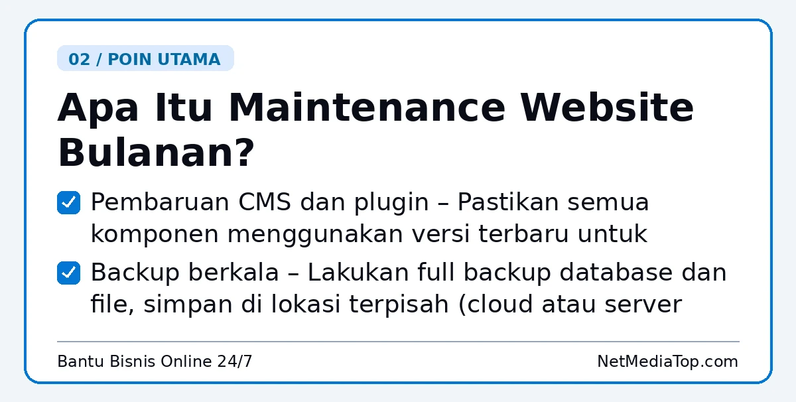
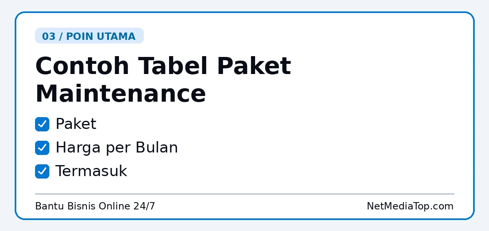
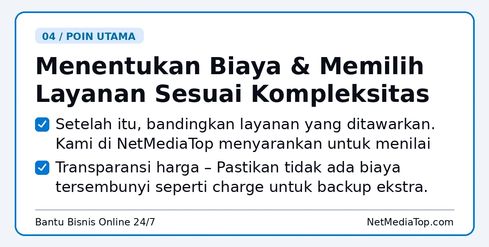
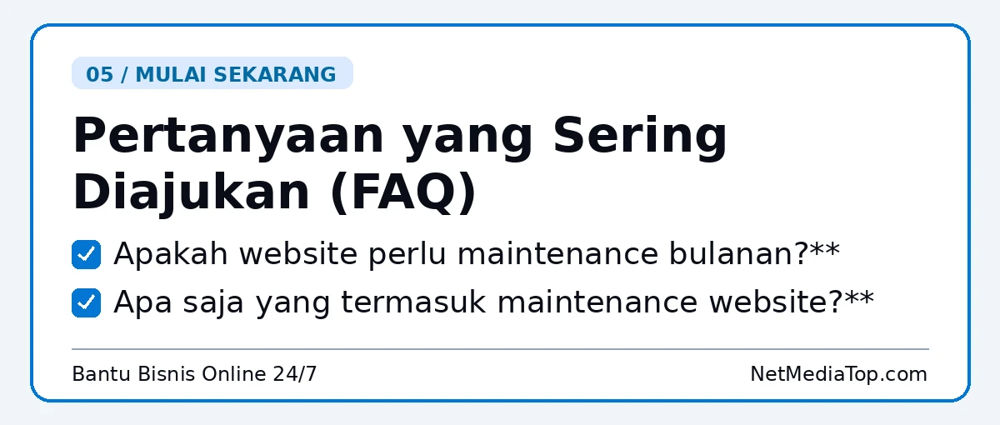

**Biaya maintenance website per bulan** bervariasi tergantung kompleksitas, platform, dan layanan yang dipilih, mulai dari Rp150.000 hingga Rp2.000.000.

## Apa Itu Maintenance Website Bulanan?
Maintenance website bulanan adalah serangkaian aktivitas rutin yang menjaga situs tetap aman, cepat, dan berfungsi sesuai harapan. Aktivitas tersebut meliputi **update plugin**, pembaruan CMS, **backup website**, pengecekan formulir, serta audit **keamanan website**. Tanpa perawatan rutin, situs dapat mengalami kerentanan, performa menurun, atau bahkan downtime yang merugikan bisnis.

Website memang tidak memerlukan perawatan tiap hari, tetapi setidaknya sebulan sekali harus melalui proses inspeksi menyeluruh. Ini menjawab pertanyaan umum: *Apakah website perlu maintenance bulanan?* Jawabannya ya, terutama bila situs berinteraksi dengan pengunjung, mengelola data, atau menjual produk secara online.

## Checklist Perawatan Website Bulanan
Berikut checklist yang dapat dijadikan acuan bagi pemilik situs. Daftar ini bersifat fleksibel; Anda dapat menyesuaikannya dengan tingkat kompleksitas situs.

- **Pembaruan CMS dan plugin** – Pastikan semua komponen menggunakan versi terbaru untuk menutup celah keamanan.
- **Backup berkala** – Lakukan full backup database dan file, simpan di lokasi terpisah (cloud atau server lain).
- **Pemeriksaan formulir & link** – Uji semua formulir kontak, checkout, serta link internal untuk menghindari error 404.
- **Audit keamanan** – Scan malware, periksa SSL, dan pastikan tidak ada login brute‑force.
- **Optimasi kecepatan** – Bersihkan cache, optimalkan gambar, dan cek waktu respon server.
- **Analisis performa** – Gunakan Google PageSpeed Insights atau GTmetrix, catat skor dan rekomendasi.

### Contoh Tabel Paket Maintenance
| Paket      | Harga per Bulan | Termasuk                              | Cocok untuk               |
|-----------|----------------|---------------------------------------|---------------------------|
| Basic     | Rp150.000      | Update plugin, backup harian, laporan | Blog pribadi, portofolio |
| Standard  | Rp500.000      | Semua di Basic + audit keamanan, optimasi kecepatan | UKM, website company profile |
| Premium   | Rp1.200.000    | Semua di Standard + monitoring 24/7, pengelolaan konten, support prioritas | Toko online, marketplace, situs dengan traffic tinggi |

Tabel di atas menggambarkan bagaimana harga **maintenance website per bulan** dapat bereskalasi seiring kebutuhan. Paket Premium biasanya diperlukan untuk situs e‑commerce yang memproses transaksi harian.

## Menentukan Biaya & Memilih Layanan Sesuai Kompleksitas
Langkah pertama adalah mengidentifikasi kompleksitas situs Anda:
1. **Jumlah halaman & fitur** – Situs satu halaman dengan sedikit gambar memerlukan perawatan minimal dibandingkan portal dengan ratusan produk.
2. **Platform** – WordPress, Shopify, atau custom code memiliki tingkat biaya yang berbeda. WordPress biasanya memerlukan update plugin yang lebih sering.
3. **Kebutuhan keamanan** – Situs yang mengumpulkan data sensitif (mis. data pelanggan) memerlukan audit keamanan lebih intensif.

Setelah itu, bandingkan layanan yang ditawarkan. Kami di NetMediaTop menyarankan untuk menilai tiga hal utama:
- **Transparansi harga** – Pastikan tidak ada biaya tersembunyi seperti charge untuk backup ekstra.
- **Laporan bulanan** – Laporan yang jelas membantu Anda mengerti apa yang telah dikerjakan.
- **Responsivitas tim** – Layanan support 24/7 sangat penting bila situs mengalami gangguan kritis.

Sebagai contoh, klien kami yang memiliki **website toko online untuk UMKM** memilih paket Standard karena mereka membutuhkan audit keamanan dan optimasi kecepatan tiap bulan. Dengan harga Rp500.000, mereka menghindari downtime selama promosi bulanan, sehingga penjualan tetap stabil.

Anda dapat membaca lebih lanjut tentang layanan kami di halaman [Jasa Pembuatan Website](/services/jasa-pembuatan-website) atau melihat contoh **website company profile untuk bisnis lokal** di [Website Company Profile untuk Bisnis Lokal](/blog/website-company-profile-bisnis-lokal). Jika fokus Anda pada e‑commerce, cek juga [Website Toko Online atau Marketplace untuk UMKM](/blog/website-toko-online-atau-marketplace).

## Studi Kasus: Perawatan Situs Bisnis Kecil
Tim NetMediaTop beberapa bulan lalu menangani situs **Bistro Aroma**, sebuah restoran kecil yang mengandalkan pemesanan online. Tantangan utama: plugin reservasi sering gagal setelah update WordPress, dan backup tidak rutin sehingga data menu hilang.

Kami melakukan langkah berikut:
- Membuat backup penuh sebelum melakukan update CMS.
- Mengganti plugin reservasi dengan alternatif yang lebih stabil.
- Menetapkan jadwal backup harian otomatis ke Google Drive.
- Melakukan audit keamanan dan memperbaiki celah XSS.

Hasilnya, dalam tiga bulan ke depan situs tetap online 99,9%, dan pemilik restoran melaporkan peningkatan pemesanan sebesar 22% karena formulir reservasi tidak lagi error. Biaya maintenance yang kami kenakan adalah Rp600.000 per bulan, termasuk laporan mingguan yang dikirimkan via email.

**Catatan Pengalaman Penulis:** Saya pribadi terlibat dalam proses audit keamanan dan backup, sehingga memahami betul pentingnya checklist bulanan yang terstruktur.

## Pertanyaan yang Sering Diajukan (FAQ)
**Apakah website perlu maintenance bulanan?**
Ya, terutama untuk situs yang aktif secara konten atau transaksi; perawatan bulanan mencegah kerentanan dan memastikan performa optimal.

**Apa saja yang termasuk maintenance website?**
Pembaruan CMS & plugin, backup rutin, pengecekan formulir, audit keamanan, optimasi kecepatan, dan laporan bulanan.

**Berapa biaya perawatan website?**
Biaya bervariasi mulai dari Rp150.000 untuk paket Basic hingga Rp2.000.000 untuk layanan premium, tergantung pada platform, fitur, dan tingkat keamanan yang dibutuhkan.

## Kesimpulan
Menentukan **biaya maintenance website per bulan** tidak boleh bersifat acak; sesuaikan paket dengan kompleksitas situs, tingkat keamanan yang dibutuhkan, dan kapasitas anggaran. Gunakan checklist bulanan sebagai pedoman, pilih layanan yang transparan, dan pantau laporan rutin untuk memastikan investasi Anda memberikan nilai maksimal.
