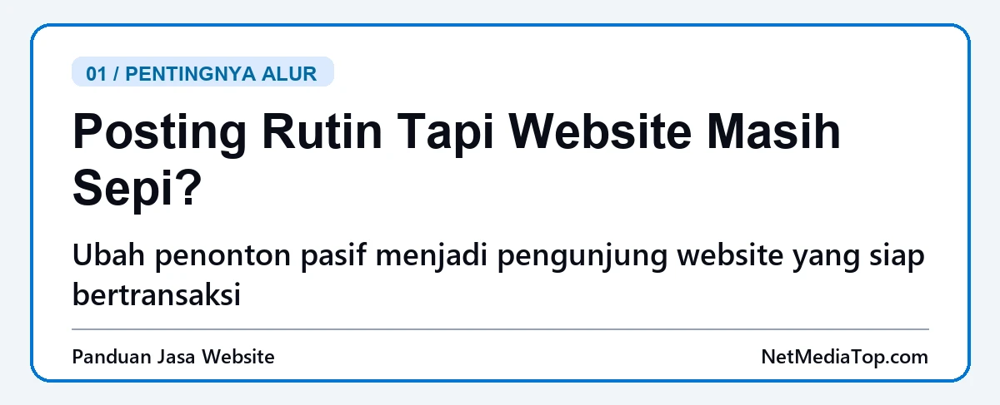
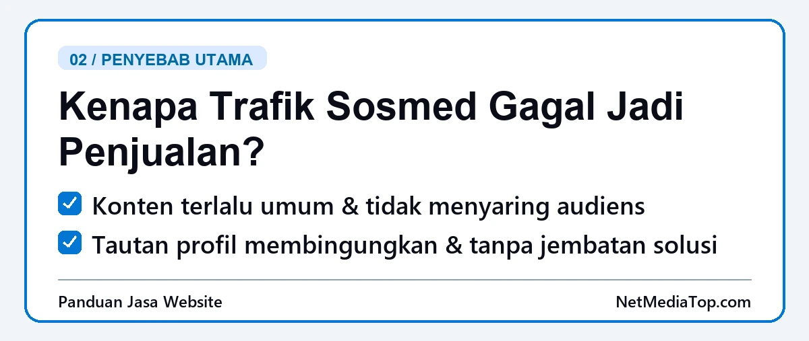
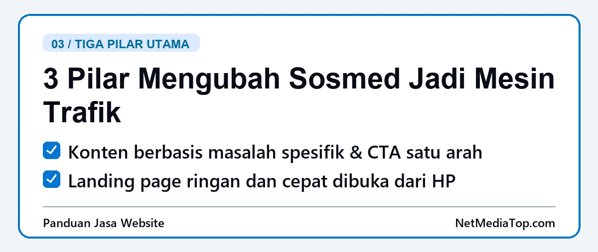
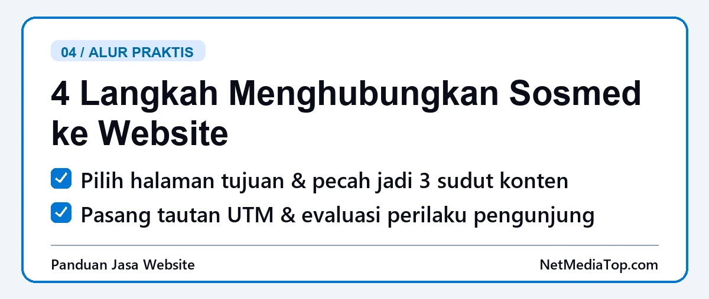
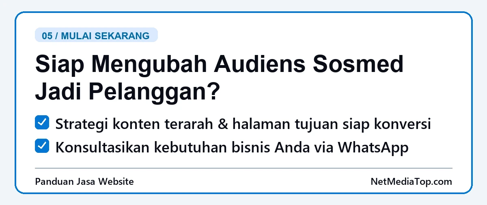

Banyak pemilik bisnis rutin mengunggah konten di Instagram, TikTok, maupun Facebook, namun jumlah kunjungan ke website dan pesan masuk tetap jalan di tempat.

Masalah utamanya bukan pada kurangnya jumlah postingan, melainkan belum adanya jembatan yang mengarahkan perhatian audiens menuju halaman penawaran yang jelas.

Dengan menyelaraskan topik konten, ajakan bertindak, dan halaman tujuan, media sosial dapat berfungsi sebagai mesin distribusi trafik tertarget yang bekerja setiap hari.

## Mengapa Trafik dari Media Sosial Sering Tidak Menghasilkan Penjualan?

Mendapatkan banyak tayangan atau tanda suka belum otomatis mendatangkan calon pembeli. Ketika alur dari konten menuju transaksi terputus, audiens hanya berhenti sebagai penonton pasif.

### 1. Konten terlalu umum dan tidak menyaring audiens
Topik yang hanya mengejar hiburan memang mudah mendapat jangkauan luas, tetapi sebagian besar penontonnya tidak memiliki kebutuhan terhadap produk atau layanan Anda.

### 2. Tautan profil mengarah ke halaman yang membingungkan
Banyak akun menaruh tautan yang membawa pengunjung ke halaman beranda yang terlalu padat atau daftar tautan tanpa konteks, sehingga pengunjung langsung menutup layar.

### 3. Tidak ada jembatan antara masalah dan solusi
Konten berhenti di tips singkat tanpa memberi alasan jelas mengapa audiens perlu membuka halaman layanan atau berkonsultasi lebih lanjut.

## Tiga Pilar Mengubah Media Sosial Menjadi Sumber Trafik Tertarget

Agar pengunjung yang datang dari media sosial memiliki minat beli yang tinggi, setiap konten perlu dirancang sebagai bagian dari satu alur perjalanan pelanggan.

### Pilar 1: Konten Berbasis Masalah Spesifik (Problem-Aware)
Bahas kendala nyata yang sedang dialami target pasar Anda. Ketika seseorang merasa konten Anda relevan dengan masalahnya, ia jauh lebih terdorong untuk mengeklik tautan di profil maupun kolom komentar.

### Pilar 2: Ajakan Bertindak (CTA) yang Satu Arah
Setiap unggahan sebaiknya hanya memiliki satu tujuan langkah berikutnya—misalnya membaca panduan lengkap di artikel blog, mengecek simulasi layanan, atau membuka halaman penawaran spesifik.

### Pilar 3: Landing Page Tujuan yang Ringan di Smartphone
Mayoritas pengguna media sosial membuka tautan langsung dari peramban bawaan aplikasi di ponsel. Halaman tujuan harus memuat cepat, menampilkan inti penawaran di layar pertama, dan menyediakan tombol WhatsApp yang mudah dijangkau.

## Alur Praktis Menghubungkan Konten Sosmed ke Website

Anda tidak perlu membuat puluhan konten setiap hari untuk mulai merasakan trafik yang berkualitas. Terapkan empat tahapan berulang berikut:

1. **Tentukan satu halaman tujuan utama:** Pilih satu artikel edukasi atau halaman layanan di website yang ingin dipromosikan selama satu minggu penuh.
2. **Pecah menjadi tiga sudut pandang konten:** Buat konten singkat berupa studi kasus nyata, kesalahan umum calon pelanggan, dan daftar periksa (*checklist*) praktis yang merujuk ke halaman tersebut.
3. **Gunakan tautan khusus berparameter (UTM):** Tambahkan parameter pelacakan pada tautan bio atau cerita (*story*) agar Anda dapat melihat di Google Analytics platform mana yang mengirim pengunjung paling aktif.
4. **Evaluasi perilaku pengunjung di website:** Perhatikan berapa lama pengunjung membaca halaman dan berapa banyak yang menekan tombol konsultasi, lalu perbaiki bagian yang masih membuat mereka ragu.

## Pertanyaan yang Sering Diajukan

### Platform media sosial mana yang paling efektif untuk mendatangkan trafik ke website?
Platform terbaik bergantung pada karakter audiens bisnis Anda. Instagram dan TikTok efektif untuk menjangkau audiens visual dan edukasi cepat, sedangkan Facebook dan LinkedIn kuat untuk segmen komunitas maupun layanan B2B.

### Apakah akun dengan jumlah pengikut kecil tetap bisa menghasilkan trafik tertarget?
Bisa. Kualitas dan relevansi topik jauh lebih menentukan dibandingkan sekadar jumlah pengikut, selama konten langsung menjawab kebutuhan spesifik calon pembeli dan diarahkan ke halaman tujuan yang tepat.

### Ke mana sebaiknya tautan di bio media sosial diarahkan?
Arahkan ke halaman khusus yang relevan dengan kampanye berjalan—seperti halaman layanan utama, artikel panduan mendalam, atau halaman konsultasi—bukan halaman yang membuat pengunjung harus mencari informasi sendiri.

## Siap Mengoptimalkan Konten Sosmed dan Website Bisnis Anda?

Jangan biarkan perhatian audiens di media sosial berlalu tanpa arah yang terukur. Susun strategi konten yang terhubung langsung dengan website yang siap menerima calon pelanggan.

Konsultasikan perencanaan konten media sosial dan pengembangan website bisnis Anda bersama tim NetMediaTop.

**[Konsultasi Strategi Sosmed & Website via WhatsApp](https://wa.me/6282329188998?text=Halo%20NetMediaTop%2C%20saya%20ingin%20konsultasi%20strategi%20konten%20sosmed%20dan%20website.)**

