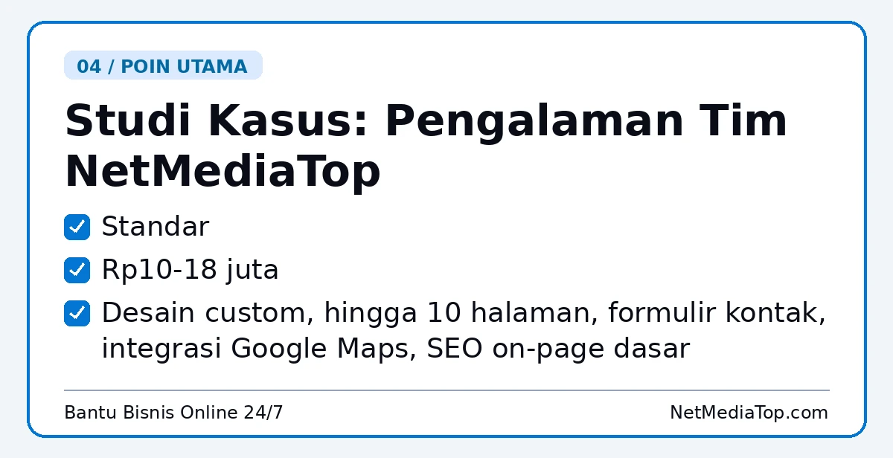

# Panduan Memahami Rincian Penawaran Biaya Jasa Pembuatan Website Company Profile

**Biaya jasa pembuatan website company profile** biasanya berada di rentang Rp5 juta hingga Rp25 juta, tergantung pada kompleksitas fitur, desain, serta layanan tambahan yang disertakan. 

## 1. Memahami Komponen Biaya Jasa Pembuatan Website

Setiap penawaran harga harus dapat dipisahkan menjadi komponen yang jelas. Berikut poin‑poin utama yang biasanya masuk dalam kalkulasi:

- **Perencanaan & riset pasar** – Analisis kebutuhan bisnis, kompetitor, dan target audiens.
- **Desain UI/UX** – Pembuatan wireframe, mockup, dan desain visual yang sesuai branding.
- **Pengembangan Front‑end & Back‑end** – Koding halaman, sistem manajemen konten (CMS), serta integrasi API bila diperlukan.
- **Pembuatan Konten** – Penulisan copywriting, pengambilan foto, atau video profil.
- **Optimasi SEO dasar** – Struktur URL, meta tag, dan kecepatan loading.
- **Pengujian & QA** – Cross‑browser, mobile responsiveness, dan keamanan.
- **Hosting & domain** – Penyediaan server, SSL, dan email bisnis.
- **Maintenance awal** – Dukungan teknis selama 1‑3 bulan pertama.

Vendor yang transparan akan menuliskan masing‑masing biaya ini dalam proposal sehingga klien dapat membandingkan secara objektif. 

## 2. Paket Harga dan Simulasi Penawaran

Berikut contoh simulasi paket yang kami gunakan dalam penawaran kepada klien bisnis menengah. Angka bersifat ilustratif; harga aktual dapat berfluktuasi sesuai kebutuhan spesifik.

| Paket | Fitur Utama | Harga |
|-------|-------------|-------|
| **Basic** | Template standar, 5 halaman, SEO dasar, hosting 1 tahun | Rp5‑10 juta |
| **Standard** | Desain kustom, 8 halaman, formulir kontak, SEO lanjutan, integrasi Google Maps | Rp10‑18 juta |
| **Premium** | Desain eksklusif, 12 halaman, e‑commerce ringan, CMS lengkap, support 6 bulan, backup harian | Rp18‑25 juta |

**Catatan:** Harga dapat berubah bila ditambah modul seperti blog, multi‑bahasa, atau integrasi ERP.

Simulasi di atas membantu bisnis menilai apakah vendor menawarkan nilai yang seimbang antara biaya dan fitur. Untuk melihat layanan lengkap kami, kunjungi [Jasa Pembuatan Website](/services/jasa-pembuatan-website). 

## 3. Faktor yang Mempengaruhi Durasi Pengerjaan

Selain biaya, klien biasanya menanyakan berapa lama proses pembuatan website. Durasi dipengaruhi oleh beberapa faktor:

- **Kelengkapan brief** – Semakin detail kebutuhan yang diberikan, proses desain dapat dipercepat.
- **Jumlah revisi desain** – Rata‑rata 2‑3 kali revisi; tiap revisi menambah 2‑3 hari.
- **Kompleksitas fitur** – Integrasi sistem pembayaran, API pihak ketiga, atau modul khusus memperpanjang timeline.
- **Penyediaan konten** – Foto, video, dan teks yang sudah siap mengurangi waktu produksi.
- **Testing & persetujuan** – QA menyeluruh biasanya memakan 1‑2 minggu.

Secara umum, paket Basic selesai dalam 3‑4 minggu, Standard dalam 5‑6 minggu, dan Premium dapat memakan 7‑10 minggu tergantung pada revisi dan tambahan fitur. 

## Studi Kasus: Pengalaman Tim NetMediaTop dalam Menyusun Penawaran

_Saya_ sebagai bagian tim kreatif NetMediaTop pernah menangani proyek pembuatan website company profile untuk sebuah perusahaan manufaktur skala menengah. Berikut tahapan yang kami lakukan:

1. **Kick‑off meeting** – Mengumpulkan dokumen brand guideline, target pasar, dan daftar halaman yang diinginkan.
2. **Proposal tersegmentasi** – Membuat tiga opsi paket (Basic, Standard, Premium) dengan rincian biaya per komponen, termasuk estimasi waktu.
3. **Presentasi visual** – Menunjukkan mockup awal dan contoh UI untuk membantu klien memahami nilai desain kustom.
4. **Negosiasi dan penyesuaian** – Klien menambahkan modul katalog produk, sehingga kami menyesuaikan paket Standard menjadi Rp15 juta dan menambah satu minggu pengerjaan.
5. **Delivery & training** – Setelah selesai, kami memberikan pelatihan penggunaan CMS selama 2 jam dan dokumen SOP maintenance.

Pengalaman ini menegaskan pentingnya transparansi biaya serta fleksibilitas menyesuaikan paket agar tidak ada biaya tersembunyi. Baca juga artikel kami tentang [Website Company Profile untuk Bisnis Lokal](/blog/website-company-profile-bisnis-lokal) untuk contoh implementasi lainnya.

## Pertanyaan yang Sering Diajukan (FAQ)

**Berapa biaya membuat website company profile?**

Biaya biasanya berada di antara Rp5 juta (paket dasar dengan template) hingga Rp25 juta (paket premium dengan desain eksklusif, integrasi e‑commerce, dan support jangka panjang).

**Apa saja yang termasuk dalam biaya pembuatan website?**

Semua komponen mulai dari perencanaan, desain UI/UX, pengembangan, konten, SEO dasar, hosting, serta dukungan teknis selama masa awal proyek masuk dalam paket harga.

**Berapa lama proses pembuatannya?**

Waktu pengerjaan bervariasi: paket Basic 3‑4 minggu, Standard 5‑6 minggu, dan Premium 7‑10 minggu, tergantung pada revisi, konten yang disediakan, dan kompleksitas fitur.

## Kesimpulan

Memahami rincian penawaran biaya jasa pembuatan website company profile memungkinkan bisnis membandingkan vendor secara objektif, menghindari biaya tersembunyi, dan menetapkan ekspektasi timeline yang realistis. Dengan menggunakan tabel perbandingan, daftar komponen biaya, serta studi kasus nyata, Anda dapat memilih partner yang paling cocok untuk mengangkat citra online perusahaan Anda.
