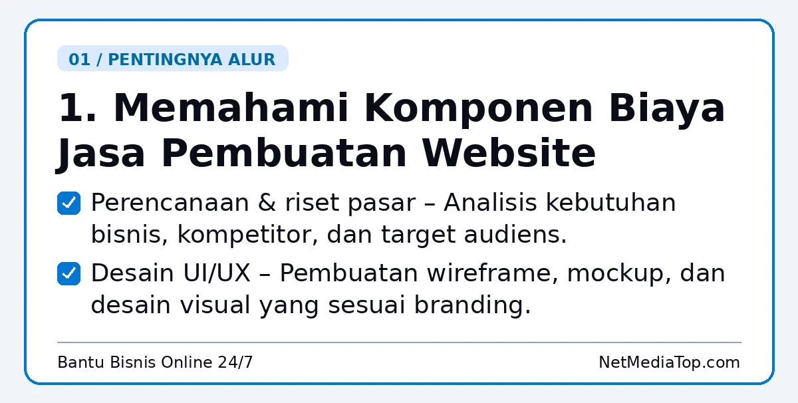
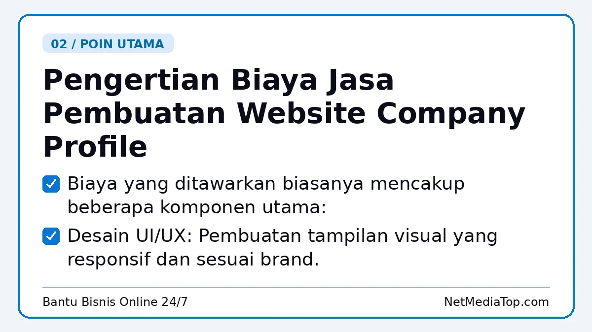
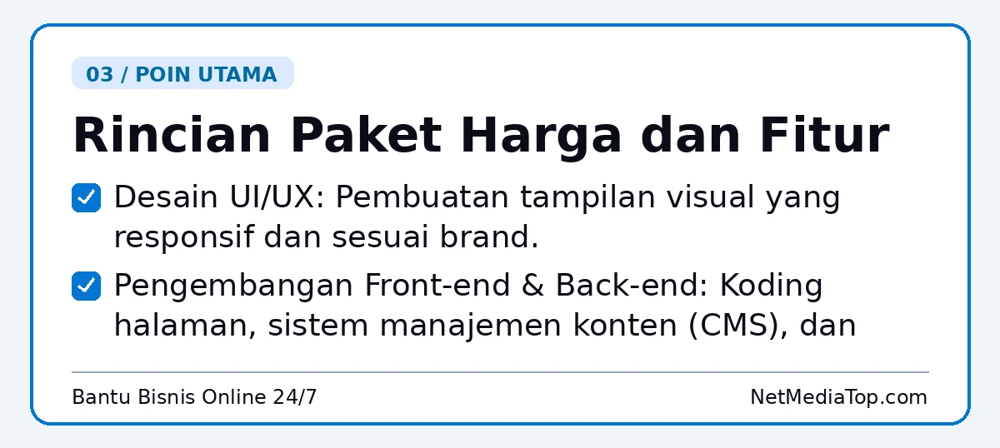
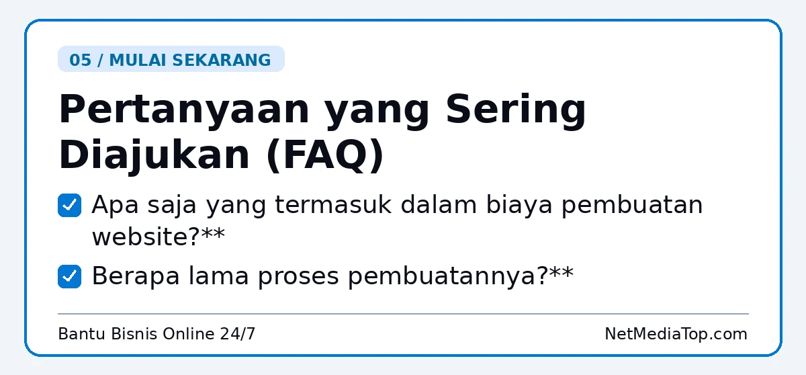

Biaya jasa pembuatan website company profile berkisar antara **Rp5 juta hingga Rp25 juta**, tergantung paket, desain, dan integrasi yang dipilih.

## Pengertian Biaya Jasa Pembuatan Website Company Profile

Biaya yang ditawarkan biasanya mencakup beberapa komponen utama:

- **Desain UI/UX**: Pembuatan tampilan visual yang responsif dan sesuai brand.
- **Pengembangan Front‑end & Back‑end**: Koding halaman, sistem manajemen konten (CMS), dan fungsionalitas khusus.
- **Konten Awal**: Penulisan teks, pemasangan foto, dan video promosi (biasanya hingga 5 halaman).
- **Hosting & Domain**: Penyediaan server dan nama domain selama satu tahun pertama.
- **Testing & Optimasi**: Pemeriksaan kecepatan, kompatibilitas browser, serta SEO dasar.
- **Pelatihan & Dokumentasi**: Panduan penggunaan CMS bagi tim internal.

Faktor yang dapat mengubah total biaya meliputi kompleksitas desain, jumlah revisi, integrasi API (mis. payment gateway), serta kebutuhan bahasa ganda. Untuk gambaran lebih luas, lihat tabel perbandingan paket di bawah.

## Rincian Paket Harga dan Fitur

| Paket | Harga (estimasi) | Fitur Utama |
|-------|------------------|--------------|
| **Dasar** | Rp5‑10 juta | Desain template standar, 3‑5 halaman statis, CMS dasar, hosting 1 tahun |
| **Standar** | Rp10‑18 juta | Desain custom, hingga 10 halaman, formulir kontak, integrasi Google Maps, SEO on‑page dasar |
| **Premium** | Rp18‑25 juta | Desain eksklusif, animasi ringan, fitur multi‑bahasa, integrasi API (CRM/ERP), kecepatan tinggi, dukungan maintenance 6 bulan |

Data di atas bersifat simulasi; vendor dapat menyesuaikan harga berdasarkan kebutuhan spesifik. Misalnya, menambah **e‑commerce ringan** atau **blog dinamis** dapat menambah biaya sekitar 20‑30%.

Sebagai contoh, jika Anda membutuhkan website dengan **desain interaktif** serta **integrasi formulir lead generation**, paket Premium menjadi pilihan yang masuk akal. Namun, untuk perusahaan yang hanya memerlukan profil singkat, paket Dasar sudah cukup.

> *Catatan:* Selalu minta rincian item per item dalam penawaran agar tidak ada biaya tersembunyi.

## Studi Kasus: Pengalaman Tim NetMediaTop

> *Catatan Pengalaman Penulis:* Pada kuartal pertama 2024, tim kami menangani proyek **PT. Solusi Digital**, sebuah perusahaan konsultan yang ingin mengubah profil lama menjadi website modern. Berikut simulasi penawaran yang kami susun sebelum finalisasi.

1. **Analisis Kebutuhan** – Mengidentifikasi 6 halaman utama (Beranda, Tentang Kami, Layanan, Portofolio, Blog, Kontak) serta kebutuhan integrasi kalender demo.
2. **Paket yang Dipilih** – Kami merekomendasikan paket *Standar* dengan harga **Rp12,5 juta** karena mencakup desain custom dan SEO dasar.
3. **Rincian Biaya**:
   - Desain UI/UX: Rp3,5 juta
   - Pengembangan CMS + 6 halaman: Rp5 juta
   - Integrasi kalender demo: Rp2 juta
   - Hosting & domain (1 tahun): Rp1 juta
   - Testing, optimasi, dan training: Rp1 juta
4. **Timeline** – Proyek selesai dalam **3 minggu** kerja (14 hari desain, 5 hari development, 2 hari testing).
5. **Hasil** – Setelah peluncuran, trafik organik naik 45% dalam 2 bulan, dan konversi lead melalui formulir kontak meningkat 30%.

Pengalaman ini mengajarkan pentingnya **transparansi biaya** serta **komunikasi timeline**. Kami selalu menyertakan dokumen RAB terperinci dan milestone yang jelas dalam setiap kontrak.

Untuk layanan serupa, kunjungi halaman utama kami di [Jasa Pembuatan Website](/services/jasa-pembuatan-website) atau baca contoh profil bisnis lokal di [Website Company Profile untuk Bisnis Lokal](/blog/website-company-profile-bisnis-lokal).

## Kesimpulan

Memahami rincian penawaran website company profile memungkinkan Anda membandingkan vendor secara objektif. Perhatikan komponen biaya, rentang harga paket, serta waktu pengerjaan. Pilih paket yang selaras dengan tujuan bisnis—apakah sekadar kehadiran online atau platform yang mendukung lead generation.

## Pertanyaan yang Sering Diajukan (FAQ)

**Berapa biaya membuat website company profile?**
Biaya biasanya berada dalam rentang **Rp5 juta sampai Rp25 juta**, tergantung paket, fitur khusus, dan kompleksitas desain.

**Apa saja yang termasuk dalam biaya pembuatan website?**
Termasuk desain UI/UX, development front‑end & back‑end, konten awal, hosting & domain, testing, optimasi SEO dasar, serta pelatihan penggunaan CMS.

**Berapa lama proses pembuatannya?**
Waktu standar berkisar **2‑4 minggu**: 1‑2 minggu untuk desain, 1‑2 minggu untuk development dan testing. Proyek lebih kompleks dapat memakan waktu hingga 6‑8 minggu.
