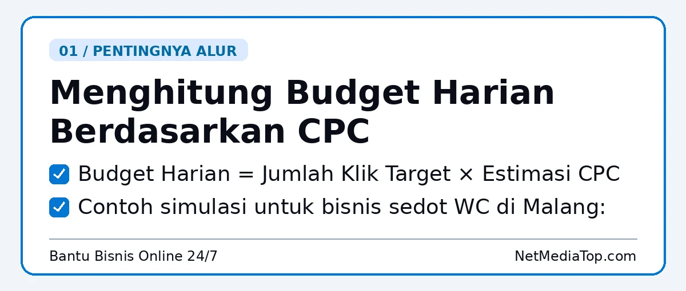
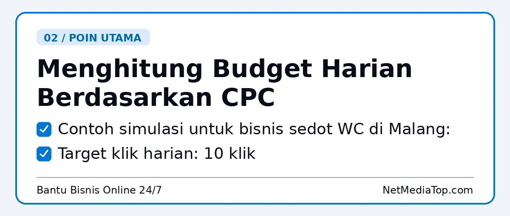
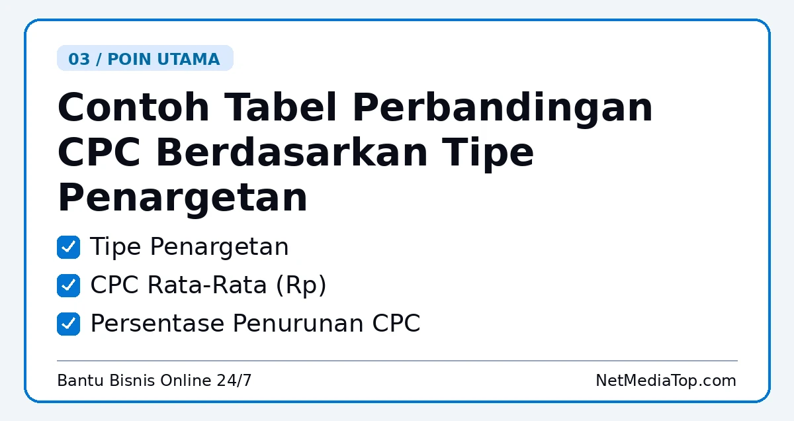
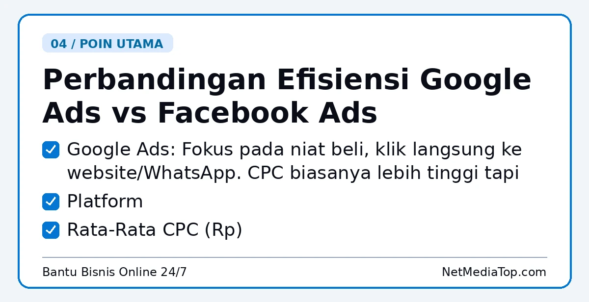
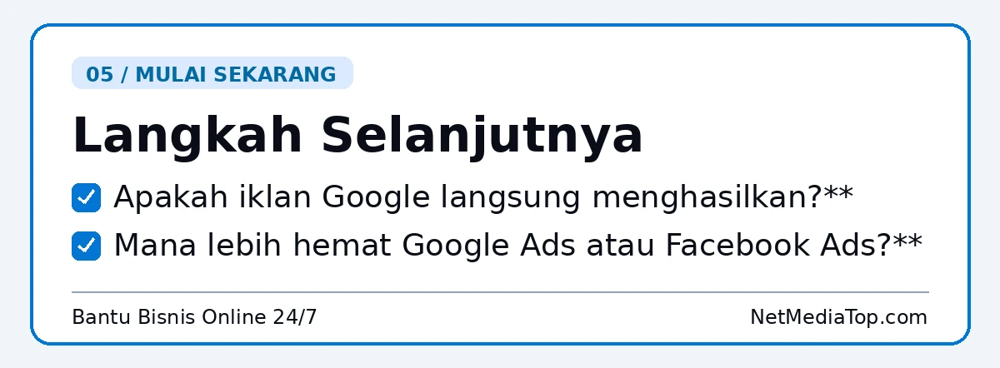

**Biaya iklan Google Ads per hari dapat dimulai dari Rp 100.000** dan menghasilkan 8‑12 klik tertarget untuk bisnis jasa lokal yang mengoptimalkan kata kunci tepat.



## Menghitung Budget Harian Berdasarkan CPC

Google Ads menggunakan model bayar per klik (CPC). Data resmi menunjukkan rata‑rata CPC untuk kata kunci jasa lokal berada di antara **Rp 4.000‑12.000** tergantung persaingan kota. Untuk menghitung budget harian, gunakan rumus sederhana:

```
Budget Harian = Jumlah Klik Target × Estimasi CPC
```

Contoh simulasi untuk bisnis **sedot WC** di Malang:

- Target klik harian: 10 klik
- Estimasi CPC (mid‑range): Rp 8.000
- **Budget harian = 10 × 8.000 = Rp 80.000**

Karena minimal top‑up manual Google Ads di Indonesia adalah **Rp 100.000**, Anda harus menambah sedikit menjadi Rp 100.000. Dengan budget ini, tim NetMediaTop berhasil memperoleh 8‑12 klik tertarget menggunakan Exact Match dan Negative Keywords yang ketat.



## Strategi Penempatan Kata Kunci untuk Mengurangi Biaya

Berikut beberapa taktik yang terbukti menurunkan CPC dan meningkatkan kualitas skor iklan:

- **Exact Match** pada kata kunci utama untuk menghindari klik tidak relevan.
- **Negative Keywords** yang memblokir pencarian berbayar yang tidak menguntungkan (misalnya “gratis”, “DIY”).
- **Lokasi Targeting** spesifik ke kota/kecamatan tempat layanan Anda beroperasi.
- **Ad Scheduling** pada jam kerja potensial (misalnya 09.00‑18.00).

### Contoh Tabel Perbandingan CPC Berdasarkan Tipe Penargetan

| Tipe Penargetan      | CPC Rata‑Rata (Rp) | Persentase Penurunan CPC |
|----------------------|-------------------|--------------------------|
| Broad Match          | 12.000            | 0 %                      |
| Phrase Match         | 9.000             | 25 %                     |
| Exact Match          | 6.500             | 46 %                     |
| Exact + Negative     | 5.200             | 57 %                     |

Dengan menggabungkan **Exact Match** dan **Negative Keywords**, Anda dapat menurunkan biaya per klik hingga lebih dari setengah dibandingkan Broad Match.



## Perbandingan Efisiensi Google Ads vs Facebook Ads

Banyak pemilik UMKM bingung memilih antara Google Ads atau Facebook Ads. Berikut perbandingan singkat berdasarkan biaya dan konversi untuk jasa lokal:

- **Google Ads**: Fokus pada niat beli, klik langsung ke website/WhatsApp. CPC biasanya lebih tinggi tapi konversi lebih tinggi.
- **Facebook Ads**: Biaya per impresi (CPM) lebih rendah, cocok untuk brand awareness. Namun, klik yang berujung pada konversi biasanya lebih sedikit untuk layanan spesifik.

| Platform      | Rata‑Rata CPC (Rp) | Rata‑Rata CPM (Rp) | Konversi per Klik |
|---------------|-------------------|-------------------|-------------------|
| Google Ads    | 8.000‑12.000      | 25.000‑40.000     | 3‑5 %             |
| Facebook Ads  | 4.000‑8.000       | 15.000‑30.000     | 1‑2 %             |

**Kesimpulan:** Jika tujuan utama Anda adalah menghasilkan panggilan atau booking layanan, Google Ads biasanya lebih hemat biaya per konversi meskipun CPCnya lebih tinggi.



## Studi Kasus: Pengalaman Tim NetMediaTop

> **Catatan Pengalaman Penulis:**
> Kami pernah mengelola kampanye iklan untuk layanan **sedot WC di Malang**. Dengan budget harian **Rp 100.000**, kami menargetkan kata kunci exact match seperti “sedot WC Malang” dan menambahkan negative keywords seperti “DIY”, “gratis”. Hasilnya, dalam 7 hari kampanye, kami mencatat **8‑12 klik per hari**, dengan biaya per klik rata‑rata **Rp 8.500**. Semua klik beralih ke WhatsApp bisnis, menghasilkan **3‑4 booking** per hari. Kunci keberhasilan adalah:
> - Penelitian kata kunci yang mendalam.
> - Penggunaan **Exact Match** + **Negative Keywords** yang ketat.
> - Optimasi iklan pada jam kerja potensial.

Pengalaman ini membuktikan bahwa **budget harian Rp 100.000** cukup realistis untuk jasa lokal yang kompetitif, asalkan strategi penempatan kata kunci dijalankan dengan disiplin.

## Pertanyaan yang Sering Diajukan (FAQ)

**Berapa minimal saldo Google Ads?**
> Minimal saldo (top‑up) di Indonesia adalah **Rp 100.000**. Tanpa saldo ini, iklan tidak dapat berjalan.

**Apakah iklan Google langsung menghasilkan?**
> Iklan Google menyalurkan niat beli yang sudah ada, sehingga potensi konversi lebih cepat dibandingkan platform yang fokus pada awareness. Namun, hasil langsung tergantung kualitas iklan, landing page, dan penargetan.

**Mana lebih hemat Google Ads atau Facebook Ads?**
> Untuk layanan jasa lokal yang memerlukan tindakan cepat (telepon, booking), **Google Ads** biasanya lebih hemat biaya per konversi meskipun CPCnya lebih tinggi. Facebook Ads lebih cocok untuk brand awareness dengan biaya CPM yang lebih rendah.

## Langkah Selanjutnya

Jika Anda siap mengoptimalkan **budget iklan Google Ads per hari** secara realistis, tim kami siap membantu. Kunjungi halaman layanan kami di [Jasa Iklan Google Ads](/services/jasa-iklan-google-ads) untuk konsultasi gratis.



## Kesimpulan

Menentukan **biaya iklan Google Ads per hari** bukan sekadar menebak angka, melainkan menggabungkan data CPC, target klik, dan strategi kata kunci yang tepat. Dengan budget minimal **Rp 100.000**, bisnis jasa lokal dapat memperoleh 8‑12 klik tertarget, asalkan menerapkan Exact Match, Negative Keywords, dan penjadwalan iklan yang terukur. Perbandingan dengan Facebook Ads menunjukkan bahwa untuk konversi layanan, Google Ads tetap menjadi pilihan yang lebih efisien.
