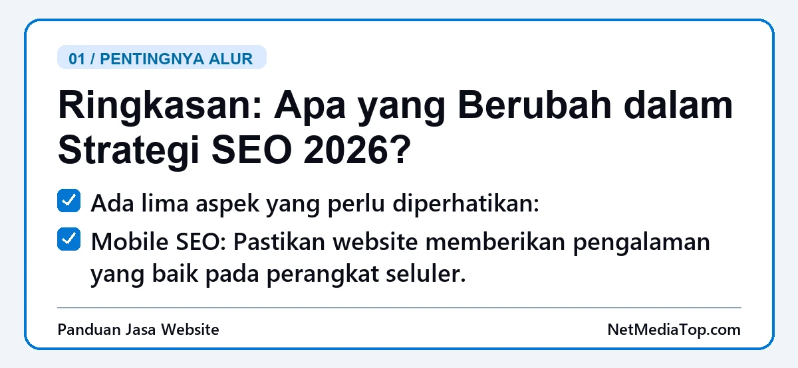
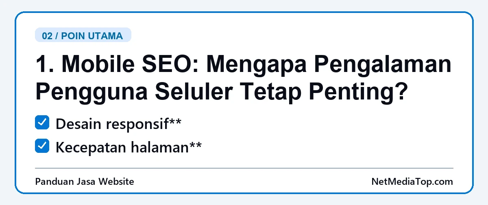
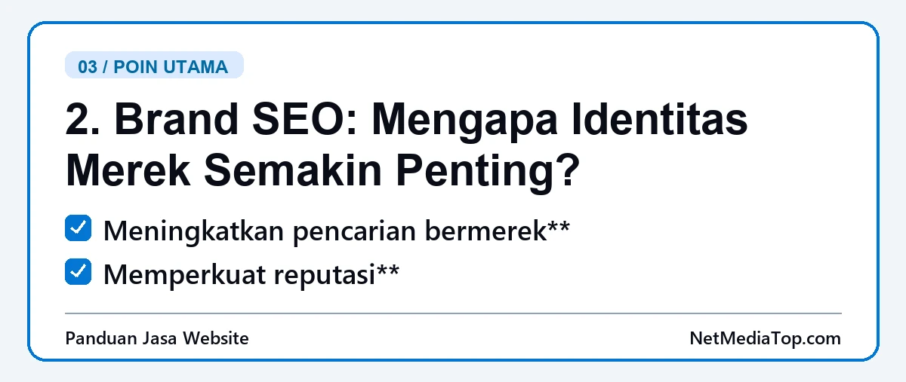
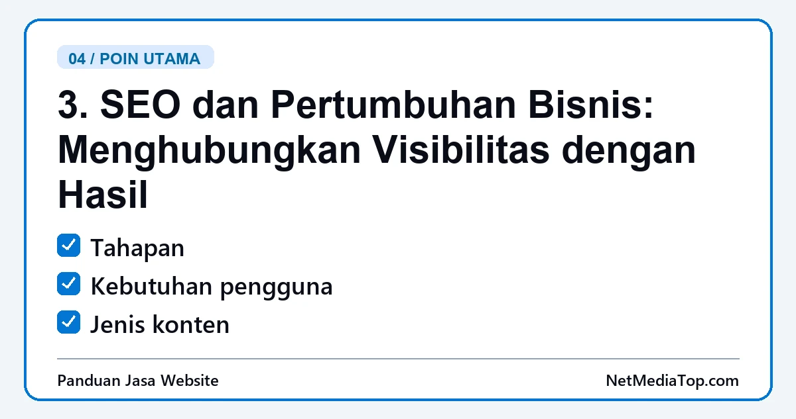
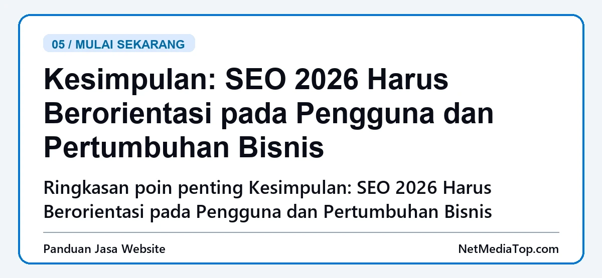

# Strategi SEO 2026: Optimasi Website untuk Google, AI Search, dan Leads

SEO terus berkembang. Perubahan perilaku pengguna, kemunculan AI Search, dan persaingan konten membuat pemilik website perlu mengevaluasi kembali cara mereka membangun visibilitas organik. Strategi yang hanya berfokus pada kata kunci dan peringkat tidak lagi cukup untuk memastikan website mampu menarik pengunjung yang tepat.

Pada 2026, SEO perlu dipandang sebagai bagian dari strategi pertumbuhan bisnis. Website harus mudah ditemukan, dipahami, dipercaya, dan mampu mengarahkan pengunjung untuk mengambil tindakan.

Artinya, optimasi tidak hanya mencakup Google Search. Bisnis juga perlu memperhatikan bagaimana konten dipahami oleh mesin pencari berbasis AI, bagaimana identitas merek dikenali, dan bagaimana pengalaman pengguna memengaruhi keputusan mereka.

Artikel ini membahas perkembangan penting dalam SEO, mulai dari mobile SEO, brand SEO, AI SEO, local search, hingga strategi praktis untuk mengubah trafik organik menjadi peluang bisnis.

## Ringkasan: Apa yang Berubah dalam Strategi SEO 2026?

Strategi SEO modern menggabungkan fondasi teknis yang sehat, konten yang menjawab search intent, identitas merek yang kuat, dan pengalaman pengguna yang baik. Website tidak cukup hanya memperoleh peringkat; website juga perlu membangun kepercayaan, memberikan informasi yang berguna, serta memudahkan pengunjung mengambil keputusan.

Ada lima aspek yang perlu diperhatikan:

1. **Mobile SEO:** Pastikan website memberikan pengalaman yang baik pada perangkat seluler.
2. **Brand SEO:** Bangun identitas dan reputasi merek agar mudah dikenali serta dipercaya.
3. **AI SEO dan GEO:** Susun konten yang jelas, terstruktur, dan memiliki informasi yang dapat dipahami sistem AI.
4. **Technical SEO:** Pastikan halaman dapat dirayapi, diindeks, dan diakses dengan baik.
5. **Conversion SEO:** Hubungkan trafik organik dengan tujuan bisnis, seperti pertanyaan, konsultasi, dan penjualan.

!{}

## 1. Mobile SEO: Mengapa Pengalaman Pengguna Seluler Tetap Penting?

Mobile SEO adalah proses mengoptimalkan website agar dapat diakses, dibaca, dan digunakan dengan baik melalui perangkat seluler. Optimasi ini mencakup desain responsif, kecepatan halaman, keterbacaan konten, navigasi, dan kemudahan pengguna menyelesaikan tindakan.

Perangkat seluler telah menjadi bagian penting dari perilaku pencarian. Pengguna mengakses informasi, membandingkan produk, mencari layanan, dan melakukan transaksi melalui ponsel.

Perubahan ini berkaitan erat dengan pendekatan mobile-first indexing yang digunakan Google. Karena itu, versi mobile website perlu mendapatkan perhatian serius dalam proses optimasi.

### Apa yang perlu diperiksa pada mobile SEO?

**1. Desain responsif**

Tampilan website harus menyesuaikan ukuran layar. Pengguna tidak seharusnya memperbesar layar atau menggeser halaman secara horizontal hanya untuk membaca informasi.

**2. Kecepatan halaman**

Halaman yang lambat dapat mengganggu pengalaman pengguna. Periksa ukuran gambar, penggunaan JavaScript, CSS, serta elemen lain yang memengaruhi waktu pemuatan.

**3. Keterbacaan konten**

Gunakan ukuran huruf yang nyaman, paragraf yang tidak terlalu panjang, dan jarak antarelemen yang cukup.

**4. Navigasi yang mudah**

Menu, tombol, formulir, dan tautan harus mudah digunakan melalui layar sentuh.

**5. Kesetaraan konten desktop dan mobile**

Pastikan informasi penting tidak hilang dari versi mobile. Konten utama, tautan internal, metadata, dan elemen penting lainnya perlu diperhatikan.

Mobile SEO bukan sekadar membuat website terlihat bagus di ponsel. Tujuan utamanya adalah memastikan pengguna dapat menemukan informasi dan menyelesaikan kebutuhannya tanpa hambatan.

## 2. Brand SEO: Mengapa Identitas Merek Semakin Penting?

Brand SEO adalah pendekatan optimasi pencarian yang membantu sebuah merek lebih mudah ditemukan melalui pencarian bermerek, sekaligus memperkuat kepercayaan pengguna terhadap bisnis tersebut.

Ketika seseorang mencari nama perusahaan, produk, layanan, atau tokoh yang terkait dengan sebuah merek, pencarian tersebut dapat menjadi indikasi bahwa pengguna sudah mengenal atau sedang mempertimbangkan bisnis tersebut.

### Bagaimana branding mendukung SEO?

**Meningkatkan pencarian bermerek**

Ketika orang mulai mengenal bisnis, mereka mungkin mencari nama merek secara langsung. Hal ini membuka peluang bagi website untuk memperoleh kunjungan dari pengguna yang sudah memiliki ketertarikan.

**Memperkuat reputasi**

Informasi yang konsisten mengenai bisnis, layanan, profil perusahaan, dan pengalaman pelanggan membantu membangun identitas yang lebih jelas.

**Mendukung peluang memperoleh tautan dan penyebutan merek**

Konten yang bermanfaat dan memiliki sudut pandang unik berpeluang dibagikan, dirujuk, atau dibicarakan oleh pihak lain.

**Membantu sistem memahami entitas bisnis**

Identitas bisnis yang konsisten di website dan sumber tepercaya lainnya membantu memperjelas hubungan antara merek, layanan, produk, dan bidang keahliannya.

### Langkah membangun Brand SEO

- Gunakan nama merek secara konsisten.
- Buat halaman profil bisnis yang menjelaskan siapa Anda dan layanan yang ditawarkan.
- Publikasikan konten yang menunjukkan keahlian.
- Bangun reputasi melalui pengalaman pelanggan dan sumber eksternal yang relevan.
- Pastikan informasi bisnis konsisten di berbagai platform.
- Hubungkan artikel, halaman layanan, dan profil penulis melalui internal link yang relevan.

Bagi bisnis yang ingin tumbuh melalui pencarian organik, brand SEO perlu menjadi bagian dari strategi jangka panjang, bukan hanya aktivitas optimasi kata kunci.

!{}

## 3. SEO dan Pertumbuhan Bisnis: Menghubungkan Visibilitas dengan Hasil

SEO yang baik tidak berhenti pada peningkatan jumlah pengunjung. Visibilitas organik perlu diarahkan untuk membantu bisnis memperoleh calon pelanggan yang sesuai.

Banyak website memiliki artikel dan trafik, tetapi belum mampu menghasilkan prospek. Salah satu penyebabnya adalah konten tidak terhubung dengan kebutuhan pengguna dan tujuan bisnis.

Sebagai contoh, seseorang yang mencari informasi tentang biaya pembuatan website memiliki kebutuhan yang berbeda dengan seseorang yang mencari jasa pembuatan website profesional. Keduanya membutuhkan konten yang berbeda pula.

### Hubungkan search intent dengan tahapan keputusan

| Tahapan | Kebutuhan pengguna | Jenis konten |
|---|---|---|
| Awareness | Memahami masalah | Panduan, edukasi, artikel informatif |
| Consideration | Membandingkan solusi | Perbandingan, studi kasus, penjelasan layanan |
| Decision | Memilih penyedia jasa | Halaman layanan, portofolio, konsultasi |

Website perlu menyediakan jalur yang jelas dari artikel informatif menuju halaman yang relevan.

Misalnya, artikel tentang strategi SEO dapat mengarahkan pembaca ke halaman [jasa SEO NetMediaTop](https://netmediatop.com/services/jasa-seo). Sementara itu, pembaca yang membutuhkan trafik berbayar dapat diarahkan ke layanan [jasa iklan Google Ads](https://netmediatop.com/services/jasa-iklan-google-ads).

### Apa yang perlu diukur?

Jangan hanya mengukur jumlah pengunjung. Perhatikan juga:

- Organic clicks dan impressions.
- Peringkat kata kunci yang relevan.
- Engagement pada halaman penting.
- Klik menuju halaman layanan.
- Jumlah formulir atau pertanyaan masuk.
- Kualitas leads yang diperoleh.
- Konversi dari pengunjung menjadi pelanggan.

Dengan pengukuran tersebut, SEO dapat dievaluasi berdasarkan kontribusinya terhadap bisnis, bukan hanya berdasarkan posisi kata kunci.

## 4. AI SEO: Mengoptimalkan Website untuk Ekosistem Pencarian Berbasis AI

AI SEO merupakan pendekatan penggunaan kecerdasan buatan dalam proses optimasi mesin pencari sekaligus penyesuaian konten agar lebih mudah dipahami oleh sistem pencarian berbasis AI.

Ada dua sisi yang perlu dibedakan.

Pertama, penggunaan AI untuk membantu pekerjaan SEO, seperti riset topik, analisis kata kunci, pengelompokan search intent, dan evaluasi konten.

Kedua, optimasi website agar informasi di dalamnya memiliki struktur dan konteks yang jelas sehingga dapat dipahami oleh sistem AI.

Keduanya saling berhubungan, tetapi tidak sama.

### Bagaimana AI mengubah proses SEO?

AI dapat membantu mempercepat beberapa pekerjaan, antara lain:

- Mengelompokkan kata kunci berdasarkan topik dan intent.
- Menemukan pertanyaan yang sering diajukan pengguna.
- Membantu membuat kerangka artikel.
- Menganalisis kesenjangan konten.
- Mengidentifikasi peluang internal linking.
- Membantu mengevaluasi struktur informasi.

Namun, penggunaan AI tidak otomatis membuat sebuah artikel berkualitas.

Konten yang hanya mengulang informasi umum tanpa pengalaman, bukti, atau sudut pandang yang jelas tetap berisiko tidak memberikan nilai tambah kepada pembaca.

### Bagaimana membuat konten yang lebih mudah dipahami AI?

**Gunakan struktur informasi yang jelas.**

Setiap halaman sebaiknya memiliki satu topik utama, judul yang relevan, subjudul yang terorganisasi, dan penjelasan yang tidak saling bertentangan.

**Berikan jawaban langsung.**

Untuk pertanyaan tertentu, berikan jawaban ringkas di awal sebelum membahas penjelasan lebih mendalam.

**Perkuat konteks entitas.**

Jelaskan hubungan antara bisnis, produk, layanan, lokasi, dan bidang keahlian. Jangan mengandalkan penyebutan kata kunci tanpa konteks.

**Gunakan data terstruktur yang relevan.**

Schema markup dapat membantu menjelaskan jenis konten dan informasi pada halaman. Namun, penerapannya harus sesuai dengan isi halaman dan pedoman mesin pencari.

**Tampilkan bukti dan pengalaman.**

Gunakan contoh implementasi, proses kerja, hasil yang dapat dipertanggungjawabkan, dan penjelasan yang menunjukkan pemahaman nyata terhadap topik.

AI sebaiknya menjadi alat bantu untuk meningkatkan kualitas proses, bukan pengganti pengetahuan dan pengalaman manusia.

!{}

## 5. Is SEO Dead in 2026? Apakah SEO Masih Efektif?

SEO belum kehilangan relevansinya. Namun, cara orang menemukan informasi terus berubah. Pengguna kini dapat memperoleh jawaban melalui hasil pencarian tradisional, ringkasan AI, platform video, komunitas, dan berbagai sumber lainnya.

Pertanyaan yang lebih tepat bukan apakah SEO sudah mati, melainkan bagaimana strategi SEO perlu beradaptasi dengan perubahan perilaku pencarian.

### Mengapa SEO masih penting?

**Pengguna tetap membutuhkan informasi**

Meskipun cara pencarian berubah, kebutuhan untuk menemukan jawaban, membandingkan produk, dan memilih layanan tetap ada.

**Website tetap menjadi aset digital bisnis**

Website memberikan ruang bagi bisnis untuk menjelaskan layanan, menunjukkan portofolio, menyampaikan informasi, dan mengarahkan pengunjung menuju tindakan.

**Pencarian organik dapat mendukung pertumbuhan jangka panjang**

Konten yang relevan dan bermanfaat dapat terus mendatangkan pengunjung selama halaman tersebut memenuhi kebutuhan pencarian.

**SEO dapat terhubung dengan saluran pemasaran lain**

Informasi dari riset SEO dapat membantu strategi konten, iklan berbayar, media sosial, dan pengembangan produk.

### Apa yang perlu diubah?

Pendekatan lama yang hanya mengejar volume kata kunci perlu dilengkapi dengan pemahaman search intent, kualitas informasi, reputasi merek, dan pengalaman pengguna.

SEO juga perlu dievaluasi berdasarkan hasil yang lebih luas, seperti kualitas trafik, leads, dan kontribusi terhadap penjualan.

Dengan demikian, SEO bukan strategi yang harus ditinggalkan. SEO adalah disiplin pemasaran yang perlu terus disesuaikan dengan perkembangan teknologi dan perilaku pengguna.

## 6. Local SEO di Era LLM: Bagaimana Bisnis Lokal Dapat Lebih Mudah Ditemukan?

Local SEO adalah proses mengoptimalkan kehadiran bisnis agar lebih mudah ditemukan oleh pengguna yang mencari produk atau layanan di lokasi tertentu.

Perkembangan AI Search dan large language models (LLM) membawa perubahan pada cara pengguna menemukan bisnis lokal. Seseorang dapat bertanya kepada AI tentang penyedia jasa terbaik, rekomendasi tempat, atau layanan yang sesuai dengan kebutuhannya.

Karena itu, bisnis lokal perlu memperhatikan bukan hanya peringkat pada pencarian berbasis lokasi, tetapi juga kejelasan informasi dan reputasi entitas bisnis.

### Strategi Local SEO yang perlu diterapkan

**1. Lengkapi profil bisnis**

Pastikan nama bisnis, alamat, nomor telepon, kategori, jam operasional, dan informasi layanan akurat.

**2. Bangun halaman layanan berdasarkan lokasi**

Jika bisnis melayani beberapa kota, buat halaman yang benar-benar memberikan informasi relevan untuk setiap wilayah. Hindari sekadar mengganti nama kota pada halaman yang sama.

**3. Perkuat konsistensi informasi bisnis**

Informasi bisnis perlu konsisten pada website, profil bisnis, direktori relevan, dan sumber lain yang dapat dipercaya.

**4. Gunakan schema markup yang sesuai**

Struktur data seperti LocalBusiness dapat membantu menjelaskan informasi bisnis secara terstruktur jika memang sesuai dengan jenis dan isi halaman.

**5. Kumpulkan ulasan pelanggan secara wajar**

Ulasan dapat membantu calon pelanggan memahami pengalaman orang lain. Tanggapi masukan dengan profesional dan jangan membuat ulasan palsu.

**6. Bangun konten lokal yang bermanfaat**

Bahas kebutuhan, permasalahan, karakteristik layanan, dan pertanyaan pelanggan di wilayah yang dilayani.

Local SEO yang kuat bukan sekadar membuat banyak halaman kota. Fokus utamanya adalah membangun informasi bisnis yang akurat, relevan, dan dapat dipercaya.

## 7. The 8-Step SEO Blueprint: Mengubah Optimasi Menjadi Nilai Bisnis

Strategi SEO perlu dijalankan secara sistematis. Berikut delapan langkah yang dapat digunakan sebagai kerangka kerja untuk meningkatkan kualitas website dan menghubungkan optimasi dengan hasil bisnis.

### Langkah 1: Audit kondisi website

Periksa struktur website, kecepatan, keamanan, halaman yang terindeks, tautan rusak, dan masalah teknis lainnya.

Mulailah dari halaman yang paling penting bagi bisnis, seperti homepage, halaman layanan, dan artikel yang memiliki potensi trafik.

### Langkah 2: Riset kata kunci dan search intent

Kelompokkan kata kunci berdasarkan kebutuhan pengguna. Jangan hanya melihat volume pencarian.

Pahami apakah pengguna sedang mencari informasi, membandingkan solusi, atau siap menggunakan layanan.

### Langkah 3: Bangun topical authority

Susun artikel dalam bentuk content pillar dan topic cluster.

Satu halaman pilar membahas topik utama, sementara artikel pendukung menjawab pertanyaan yang lebih spesifik. Hubungkan seluruh halaman menggunakan internal link yang relevan.

### Langkah 4: Tingkatkan kualitas konten

Pastikan setiap artikel memiliki tujuan yang jelas, informasi yang akurat, penjelasan yang mudah dipahami, dan nilai tambah bagi pembaca.

Tambahkan pengalaman, contoh, data, atau sudut pandang yang dapat memperkuat kualitas informasi.

### Langkah 5: Perbaiki technical SEO

Pastikan mesin pencari dapat menemukan dan memahami halaman website.

Periksa sitemap, robots.txt, canonical, struktur URL, status HTTP, internal link, serta implementasi schema markup.

### Langkah 6: Bangun reputasi dan identitas merek

Perkuat profil bisnis, halaman tentang perusahaan, profil penulis, portofolio, dan bukti pengalaman.

Kembangkan konten yang layak dirujuk dan dibagikan oleh sumber lain yang relevan.

### Langkah 7: Optimalkan konversi

Pastikan halaman tidak hanya memberikan informasi, tetapi juga membantu pengguna mengambil tindakan.

Gunakan CTA yang sesuai dengan kebutuhan pembaca. Sediakan formulir, informasi kontak, penjelasan layanan, dan bukti pendukung yang relevan.

### Langkah 8: Evaluasi dan tingkatkan performa

Pantau hasil melalui Google Search Console, analytics, dan alat audit yang sesuai.

Evaluasi halaman yang mengalami penurunan, artikel yang belum mendapatkan trafik, serta halaman yang sudah memperoleh kunjungan tetapi belum menghasilkan leads.

SEO adalah proses berkelanjutan. Hasil evaluasi harus menjadi dasar untuk menentukan pekerjaan berikutnya.

!{}
## 8. YouTube SEO: Mengapa Optimasi Video Perlu Masuk Strategi Konten?

YouTube SEO adalah proses mengoptimalkan video agar lebih mudah ditemukan melalui pencarian dan rekomendasi di YouTube. Walaupun menggunakan algoritma yang berbeda dari Google Search, keduanya memiliki sejumlah prinsip yang saling berhubungan, seperti relevansi, kualitas informasi, dan kepuasan pengguna.

### Elemen penting dalam YouTube SEO

**Riset topik dan kata kunci**

Cari tahu pertanyaan dan topik yang benar-benar dicari oleh target audiens. Gunakan hasil riset tersebut untuk menentukan tema video.

**Judul video**

Buat judul yang menggambarkan isi video secara jelas dan menarik tanpa memberikan janji yang tidak sesuai.

**Deskripsi video**

Jelaskan isi video, konteks pembahasan, dan informasi pendukung. Gunakan kata kunci secara natural.

**Struktur pembahasan**

Susun video agar mudah diikuti. Untuk video edukasi, gunakan urutan pembahasan yang logis dan berikan jawaban atas pertanyaan utama sejak awal.

**Thumbnail**

Buat thumbnail yang relevan dengan isi video dan mudah dikenali ketika muncul di halaman pencarian.

**Retensi penonton**

Perhatikan apakah penonton bertahan menonton video atau meninggalkannya terlalu cepat. Evaluasi bagian yang membuat audiens kehilangan minat.

### Hubungan YouTube SEO dengan strategi website

Video dapat digunakan untuk memperluas distribusi konten. Artikel blog dapat dikembangkan menjadi video, sementara video dapat diarahkan kembali ke artikel atau halaman layanan yang relevan.

Dengan pendekatan ini, bisnis tidak hanya bergantung pada satu saluran distribusi.

## 9. Mobile SEO dan Pengalaman Pengguna: Hal yang Sering Terlewat

Optimasi mobile sering dianggap selesai ketika website sudah memiliki desain responsif. Padahal, pengalaman pengguna melibatkan lebih banyak aspek daripada sekadar tampilan.

Beberapa hal yang perlu diperhatikan:

- Tombol memiliki ukuran yang nyaman untuk disentuh.
- Formulir tidak terlalu panjang atau sulit diisi.
- Informasi utama mudah ditemukan.
- Gambar tidak mengganggu kecepatan halaman.
- Pop-up tidak menutupi konten utama.
- Menu navigasi mudah digunakan.
- Pengguna dapat menghubungi bisnis tanpa kesulitan.

Gunakan data dari perangkat nyata dan alat pengujian untuk menemukan masalah. Jangan hanya mengandalkan tampilan website pada satu ukuran layar.

## 10. Hubungan Branding, SEO, dan Kepercayaan Pengguna

Branding dan SEO bukan dua aktivitas yang berdiri sendiri. Keduanya dapat saling mendukung dalam membangun kehadiran digital bisnis.

SEO membantu pengguna menemukan informasi tentang bisnis. Branding membantu pengguna mengenali dan mengingat bisnis tersebut.

Ketika seseorang menemukan sebuah artikel yang bermanfaat, lalu melihat profil perusahaan yang jelas, portofolio yang relevan, dan informasi layanan yang konsisten, kepercayaan terhadap bisnis dapat terbentuk secara bertahap.

### Bagaimana memperkuat hubungan branding dan SEO?

1. Gunakan identitas visual dan nama merek secara konsisten.
2. Jelaskan keahlian dan pengalaman bisnis melalui halaman profil.
3. Buat konten yang memiliki sudut pandang dan nilai informasi yang jelas.
4. Tampilkan portofolio atau contoh pekerjaan yang dapat dipertanggungjawabkan.
5. Bangun hubungan dengan komunitas dan sumber industri yang relevan.
6. Pastikan halaman layanan menjelaskan manfaat, proses, dan batasan layanan secara transparan.

Tidak ada satu faktor branding yang otomatis menjamin peringkat pencarian. Namun, reputasi dan kejelasan identitas dapat membantu pengguna menilai kredibilitas sebuah bisnis.

## 11. Checklist Eksekusi: Apa yang Harus Dilakukan untuk Memulai SEO 2026?

Setelah memahami berbagai perkembangan SEO, langkah berikutnya adalah menentukan prioritas. Tidak semua website membutuhkan perubahan besar sekaligus.

Gunakan checklist berikut untuk memulai evaluasi:

### Fondasi website

- [ ] Website dapat diakses dengan baik melalui perangkat mobile.
- [ ] Halaman penting dapat dirayapi dan diindeks.
- [ ] Sitemap XML tersedia dan diperbarui.
- [ ] Tidak ada masalah besar pada struktur URL.
- [ ] Kecepatan dan pengalaman pengguna telah diperiksa.

### Konten dan search intent

- [ ] Setiap halaman memiliki tujuan pencarian yang jelas.
- [ ] Artikel menjawab pertanyaan utama pengguna.
- [ ] Konten memiliki informasi yang bermanfaat dan tidak sekadar mengulang.
- [ ] Internal link menghubungkan halaman yang relevan.
- [ ] Artikel penting memiliki sumber dan bukti yang dapat diverifikasi.

### Brand dan kepercayaan

- [ ] Informasi bisnis tersedia dan konsisten.
- [ ] Profil perusahaan dan penulis jelas.
- [ ] Portofolio atau bukti pengalaman ditampilkan.
- [ ] Halaman layanan menjelaskan solusi secara transparan.
- [ ] Reputasi bisnis dibangun melalui pengalaman pelanggan yang nyata.

### AI Search dan struktur informasi

- [ ] Konten memiliki struktur heading yang logis.
- [ ] Pertanyaan penting dijawab secara langsung.
- [ ] Entitas bisnis dan layanan dijelaskan dengan konsisten.
- [ ] Schema markup sesuai dengan konten halaman.
- [ ] Informasi utama mudah dipahami tanpa bergantung pada elemen visual saja.

### Konversi dan evaluasi

- [ ] CTA tersedia pada halaman yang relevan.
- [ ] Formulir dan informasi kontak berfungsi.
- [ ] Performa organik dipantau secara berkala.
- [ ] Leads dari kanal organik dicatat.
- [ ] Halaman dengan trafik tinggi tetapi konversi rendah dievaluasi.

## Kesimpulan: SEO 2026 Harus Berorientasi pada Pengguna dan Pertumbuhan Bisnis

SEO pada 2026 bukan sekadar perlombaan untuk mendapatkan peringkat tertinggi di Google. Perubahan perilaku pencarian dan perkembangan AI membuat bisnis perlu membangun strategi yang lebih menyeluruh.

Mobile SEO memastikan website nyaman digunakan. Brand SEO membantu memperkuat identitas dan kepercayaan. AI SEO dan GEO mendorong penyajian informasi yang lebih jelas bagi ekosistem pencarian modern. Technical SEO memastikan fondasi website tetap sehat, sedangkan conversion SEO menghubungkan visibilitas dengan hasil bisnis.

Tidak semua tren harus diterapkan sekaligus. Mulailah dengan mengevaluasi kondisi website, memahami kebutuhan audiens, memperbaiki halaman prioritas, dan mengukur hasilnya secara konsisten.

Jika website sudah memiliki trafik tetapi belum menghasilkan prospek, mungkin masalahnya bukan hanya pada jumlah pengunjung. Bisa jadi konten belum menjawab kebutuhan calon pelanggan, halaman layanan belum meyakinkan, atau jalur konversi belum cukup jelas.

NetMediaTop membantu bisnis mengembangkan strategi digital melalui optimasi SEO, Google Ads, dan konten yang berorientasi pada kebutuhan pelanggan. Tujuannya bukan hanya mendatangkan pengunjung, tetapi membantu bisnis membangun kehadiran digital yang lebih terarah dan menghasilkan peluang pertumbuhan.

!{}