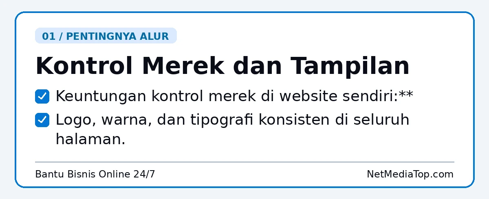
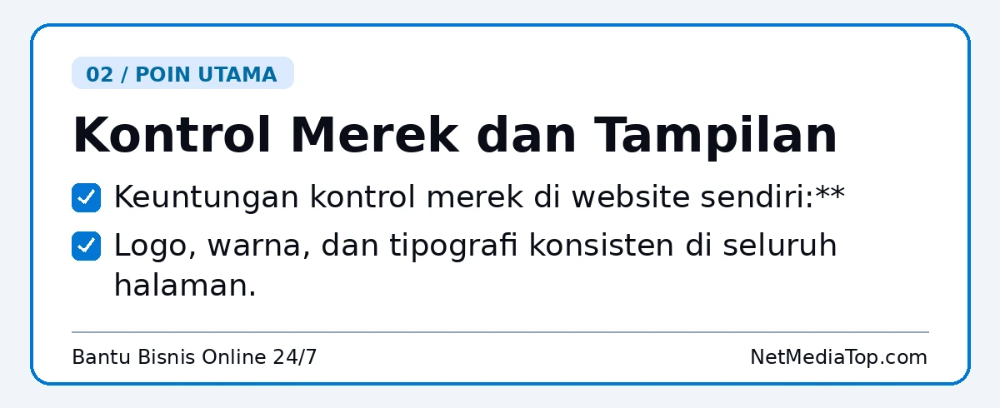
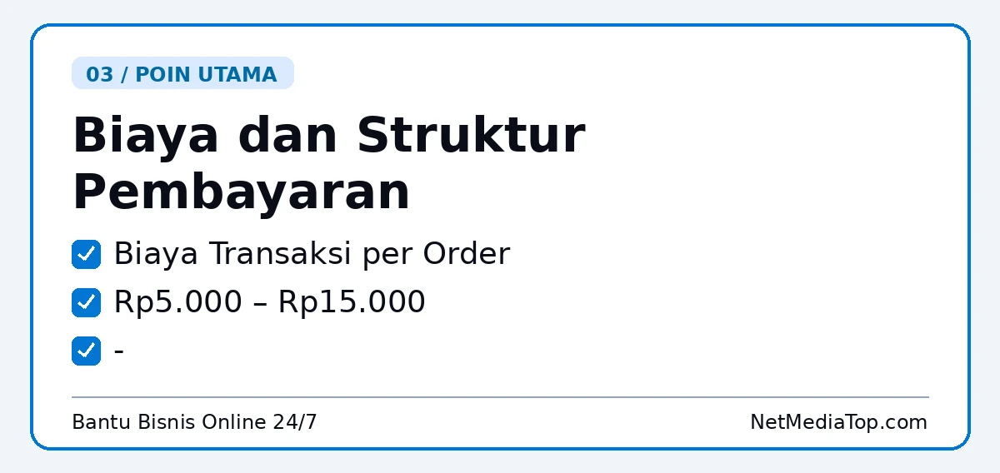
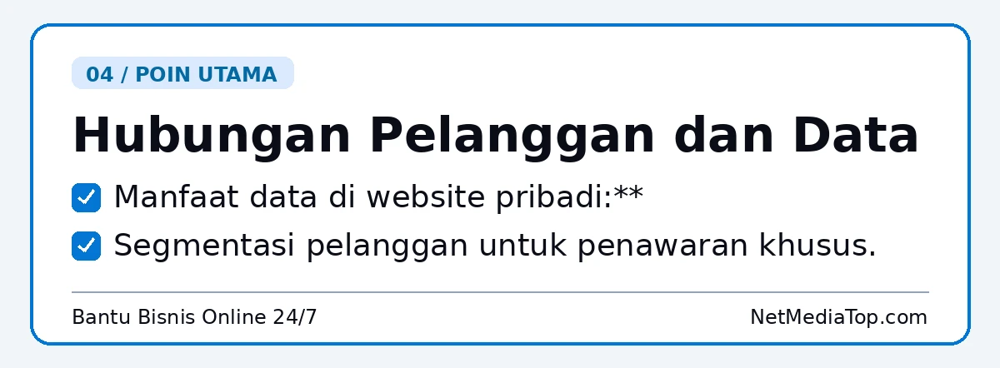
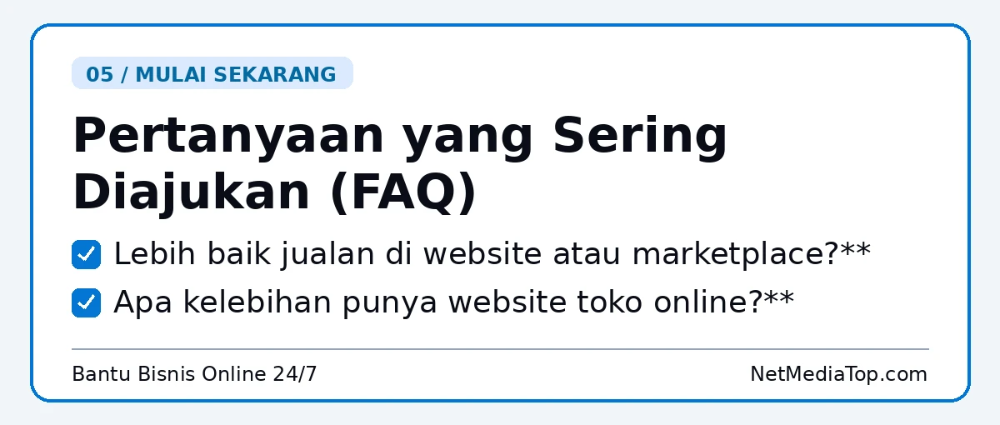

# **Website toko online atau marketplace untuk UMKM** adalah pilihan strategis yang harus dipertimbangkan dengan cermat untuk memaksimalkan penjualan dan brand awareness.

## Kontrol Merek dan Tampilan

Website pribadi memberi kebebasan total dalam menata visual, bahasa, dan struktur navigasi. UMKM dapat menonjolkan identitas budaya lokal, menambahkan cerita produk, serta menyesuaikan layout sesuai musim atau promosi. Marketplace, meskipun memiliki jutaan pembeli, membatasi desain pada template standar dan menampilkan produk di antara ribuan penjual lain.

**Keuntungan kontrol merek di website sendiri:**
- Logo, warna, dan tipografi konsisten di seluruh halaman.
- Fitur blog atau artikel edukatif untuk membangun otoritas.
- Kemampuan mengintegrasikan video, animasi, atau AR sesuai kebutuhan.

**Keterbatasan kontrol di marketplace:**
- Penempatan iklan terbatas pada slot yang disediakan.
- Tidak dapat menambahkan konten non‑produk seperti cerita brand.
- UI/UX tergantung kebijakan platform.

## Biaya dan Struktur Pembayaran

Marketplace biasanya mengenakan biaya komisi per transaksi (biasanya 5‑15 %) serta biaya iklan tambahan untuk meningkatkan visibilitas. Di sisi lain, website toko online memerlukan investasi awal untuk pengembangan, hosting, dan pemeliharaan, tetapi tidak ada komisi per penjualan. Berikut simulasi biaya bulanan untuk dua skenario umum pada tahun 2024:

| Komponen                     | Marketplace (Komisi 10 %) | Website Sendiri (Biaya Tetap) |
|------------------------------|--------------------------|------------------------------|
| Biaya Platform / Hosting     | -                        | Rp200.000 – Rp500.000        |
| Biaya Pengembangan Awal      | -                        | Rp5.000.000 – Rp15.000.000    |
| Biaya Transaksi per Order    | Rp5.000 – Rp15.000        | -                            |
| Biaya Iklan / Promosi        | Rp100.000 – Rp500.000     | Rp200.000 – Rp800.000 (Ads)  |
| Total Bulanan (asumsi 100 order) | Rp1.500.000 – Rp2.500.000 | Rp400.000 – Rp1.300.000      |

Catatan: angka bersifat simulasi, biaya riil dapat berbeda tergantung platform dan paket layanan.

**Poin penting:**
- Website memberi kepastian biaya tetap, cocok untuk UMKM dengan margin tipis.
- Marketplace mempermudah entry, namun biaya komisi dapat menggerus profit bila volume penjualan tinggi.

## Hubungan Pelanggan dan Data

Memiliki website sendiri memungkinkan pengumpulan data pelanggan secara langsung—email, riwayat pembelian, preferensi produk—yang dapat dipakai untuk email marketing, retargeting, dan program loyalitas. Marketplace menyimpan data di dalam sistem mereka; UMKM hanya mendapatkan akses terbatas pada nama pembeli dan alamat pengiriman.

**Manfaat data di website pribadi:**
- Segmentasi pelanggan untuk penawaran khusus.
- Analisis perilaku browsing dengan Google Analytics atau alat serupa.
- Integrasi CRM untuk membangun hubungan jangka panjang.

**Keterbatasan data di marketplace:**
- Tidak dapat mengirim newsletter tanpa persetujuan platform.
- Sulit melacak churn rate karena data tersebar.
- Ketergantungan pada algoritma rekomendasi platform.

## Studi Kasus: Dari Marketplace ke Website Sendiri

*Skenario hipotetis:* Saya bersama tim NetMediaTop membantu sebuah usaha kerajinan batik yang memulai penjualan di marketplace populer. Pada tiga bulan pertama, mereka memperoleh 120 order dengan rata‑rata nilai transaksi Rp150.000. Namun, komisi 12 % mengurangi margin menjadi hanya 8 %.

Kami menyarankan pembuatan website toko online khusus. Setelah investasi pengembangan sebesar Rp8.000.000, biaya hosting bulanan Rp300.000, dan kampanye iklan awal Rp400.000, penjualan online meningkat 35 % dalam dua bulan pertama. Margin kotor naik menjadi 20 % karena tidak ada komisi platform, dan data pelanggan memungkinkan kami mengirimkan promo ulang tahun yang menghasilkan tambahan Rp2.500.000.

Pengalaman ini menegaskan bahwa kombinasi awal marketplace untuk akuisisi cepat, lalu migrasi ke website pribadi untuk kontrol biaya dan data, dapat memaksimalkan pertumbuhan UMKM.

## Pertanyaan yang Sering Diajukan (FAQ)

**1. Lebih baik jualan di website atau marketplace?**
- Marketplace cocok untuk testing pasar dengan biaya masuk rendah. Website sendiri ideal untuk brand yang mengutamakan kontrol visual, biaya tetap, dan data pelanggan.

**2. Apa kelebihan punya website toko online?**
- Kebebasan desain, tidak ada komisi per penjualan, akses penuh ke data pelanggan, dan kemampuan membangun program loyalitas.

**3. Apakah UMKM perlu memakai keduanya?**
- Menggunakan keduanya memberikan sinergi: marketplace sebagai kanal akuisisi cepat, website sebagai basis brand dan retensi jangka panjang.

## Kesimpulan

Memilih antara website toko online atau marketplace bukan soal "satu lebih baik dari yang lain", melainkan tentang strategi yang sesuai dengan tujuan bisnis, anggaran, dan tingkat kontrol yang diinginkan. Dengan memahami perbedaan kontrol merek, struktur biaya, serta potensi data pelanggan, UMKM dapat merancang roadmap digital yang fleksibel—mulai dari marketplace, kemudian beralih ke website pribadi ketika brand siap menancapkan identitasnya secara mandiri.

Untuk memulai perjalanan digital yang terukur, kunjungi layanan kami **[Jasa Pembuatan Website](/services/jasa-pembuatan-website)** atau baca panduan lengkap **[Website Toko Online atau Marketplace untuk UMKM](/blog/website-toko-online-atau-marketplace)**. Pastikan website Anda tetap optimal dengan mengikuti **[Checklist Maintenance Website Bulanan](/blog/checklist-maintenance-website-bulanan)**.
